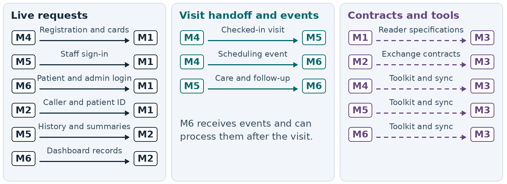

# Internal Integration

The modules talk through agreed interfaces. Each module controls its own data and shares only the information needed by the next step.

The same links have different meanings. A request arrow runs from the caller to the module it relies on for a reply. An event arrow runs from the sender to the receiver. For events, the receiver relies on the sender's message format, and the sender can finish once the event is safely published. A dotted arrow runs from the module using a contract or toolkit to M3, which supplies it.

| Connection | What goes across | What happens next |
| --- | --- | --- |
| M4 → M1 | Registration details or a presented card | M1 returns the UPID or current card status. |
| M5 → M1 and M6 → M1 | Staff, patient, or administrator sign-in | M1 verifies the user and returns identity and role information. |
| M2 → M1 | Caller and patient references | M1 validates the caller and resolves the UPID. |
| M5 → M2 | UPID, caller, purpose, record category, or approved publication | M2 returns permitted history with its source, an explicit failure, or a publication acknowledgement. |
| M6 → M2 | Signed-in patient and requested dashboard data | M2 returns only the patient's permitted records or an explicit failure. |
| M4 → M5 | Confirmed check-in and visit details | M5 adds the visit to the clinical worklist. |
| M4 → M6 and M5 → M6 | Minimal scheduling, care completion, or follow-up event | M6 starts the relevant reminder, follow-up, or billing work. |
| M1, M2, M4, M5, M6 → M3 | Use of contracts, schemas, or developer tools | M3 supplies shared versions. The sync agent runs locally in M4, M5, and M6. |

## Handling consent and failures

For a cross-facility request, M2 verifies the caller through M1, checks consent and purpose, finds the owning facility, and records the authorization decision. It then contacts the source facility through its API. The source enforces its own disclosure rules. M2 returns only the permitted result and records the disclosure. If consent is denied, the audit write fails, or the source is unavailable, the system reports the outcome without releasing records.

Card validation and protected record access require live decisions. During an outage, M3 can queue eligible work. The owning service confirms, rejects, or reports a conflict when the work is replayed. A unique operation ID makes retries safe. A pending booking stays pending until the facility confirms it.

The external connections are the originating facility API, pharmacy, insurer, and notification provider. The originating facility keeps the source record and responds through its own interface.
