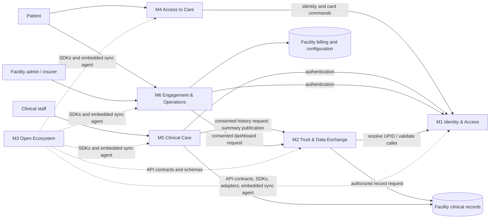
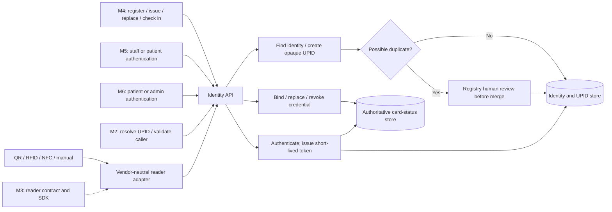
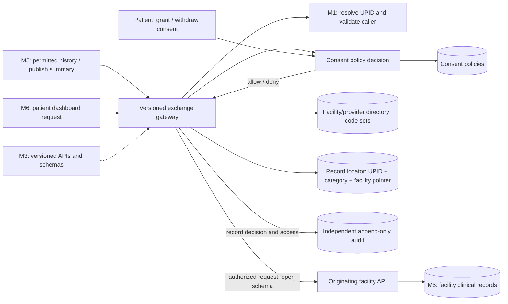
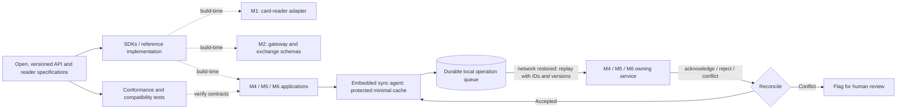
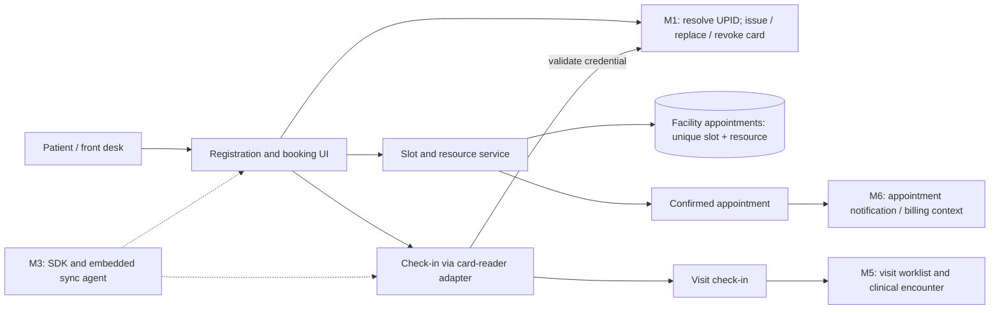
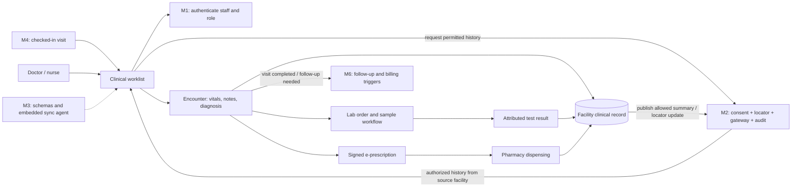
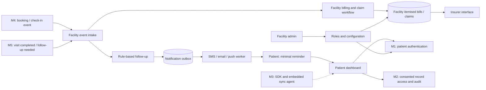
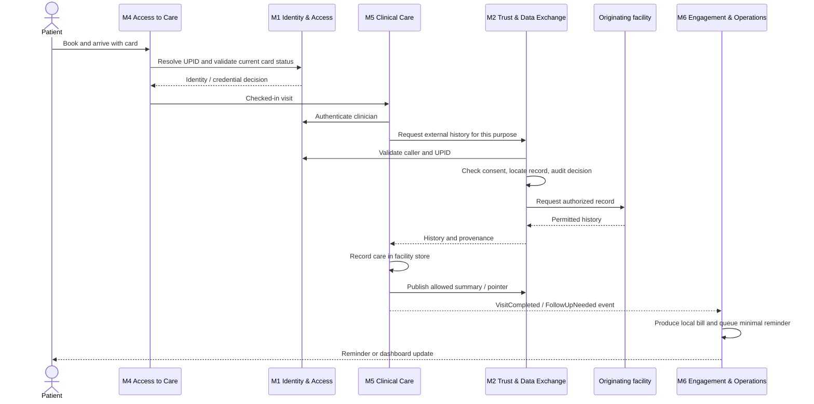

# Patient card and connected care: an architecture study

This README is my proposed architecture for the system described in [the architecture drivers PDF](CSE752-2026-17-ArchDrivers.pdf). It is a learning exercise, not an implementation. I have used patterns we study in software architecture to ask a practical question: **where should each responsibility live, and how can the modules cooperate without losing control of patient data?**

The PDF identifies ten features in six modules. I keep its module boundaries and use the same IDs throughout. Each diagram's `M1`–`M6` boxes are **connection points** to the diagrams with those headings; arrow labels name the information or request crossing the boundary. Components inside a module are proposed design choices, not requirements stated verbatim in the PDF.

## The system at a glance

I would use a **federated architecture**: facilities keep their detailed clinical and billing records, while shared services coordinate identity, consent, discovery and audit. Applications call shared services for decisions, then retrieve allowed data from the facility that owns it. Events help with follow-up work, but a consent decision cannot be postponed to an event consumer.

The solid arrows are runtime interactions. The dotted arrows are mostly build-time dependencies; the exception is M3's sync agent, which runs inside facility applications. The record store is shown beside M5 because M5 owns clinical workflows, but each facility operates its own store. M2 keeps record **pointers**, not copies of those records.

| Module | PDF features | Main architectural idea | Owns or governs |
| --- | --- | --- | --- |
| M1 Identity & Access | F1, F2 | Layered service with reader adapters | UPIDs, identity matching, credentials, card status |
| M2 Trust & Data Exchange | F3, F4, F5 | Policy enforcement plus federated gateway | Consent, audit, record pointers, registries, exchange rules |
| M3 Open Ecosystem | F6 | Ports and adapters, versioned contracts, offline queue | Specifications, SDKs, reference stack, sync agent |
| M4 Access to Care | F7 | Transactional booking workflow | Facility appointments, registration and check-in |
| M5 Clinical Care | F8 | Local clinical workflow with federated reads | Facility clinical records and care actions |
| M6 Engagement & Operations | F9, F10 | Event-driven follow-up plus local billing | Patient views, reminders, facility billing and administration |

## M1 — Identity & Access

I would separate identity rules from card hardware using **ports and adapters**. A reader translates QR, RFID, NFC or manual input into the same credential lookup. The UPID is an opaque identifier; the card carries a revocable credential, not a clinical record. Duplicate matching produces a *review candidate*, not an automatic merge.

**Connection contract:** M4 asks M1 to identify a patient and change card status. M5, M6 and M2 use M1 to authenticate or resolve identity. Every card use must check current revocation status; a long-lived offline acceptance of a lost card would contradict the PDF's immediate-revocation driver. If the shared service is unreachable, the application must state that this check is unavailable rather than silently treating a cached card as valid.

## M2 — Trust & Data Exchange

This is a **federated gateway** with a **policy decision point**. The gateway checks the caller and patient consent for *each* request, locates the owning facility, then forwards an authorized, standards-based request. A separate audit service records the decision and access in an append-only, tamper-evident log. A successful audit write should be part of the access path so an unlogged disclosure is not treated as success.

**Connection contract:** M5 and M6 submit purpose, patient UPID, caller identity and requested record category to M2. M2 returns only data that the origin facility is authorized to disclose. M1 supplies identity, while the directory and certificate-based facility trust identify the destination. The locator contains no clinical content. Rate limiting at the gateway protects many facilities from bursts; published code sets and FHIR-aligned schemas make the exchange interpretable.

## M3 — Open Ecosystem

Here I would use **ports and adapters** to make standards more than documentation. A versioned API contract defines requests and data shapes; SDKs, a reference implementation and conformance tests help independent teams implement them. The offline sync agent is embedded in applications at the facility, where it stores a protected minimal cache and a durable operation queue.

**Connection contract:** M3 defines what M1, M2, M4, M5 and M6 must agree on; it is not a central runtime database. The embedded agent synchronizes only operations permitted for that application. Each queued operation needs an idempotency key so retrying cannot create duplicate appointments, orders or charges. Conflicts in clinical facts or identity merges need review rather than last-write-wins. Offline mode can support local work, but new cross-facility disclosures and card validity checks still require live trust decisions.

## M4 — Access to Care

For booking I would use a **transactional workflow** at the facility: reserve a slot with a uniqueness rule, then confirm the appointment. This is preferable to an asynchronous event for preventing two people from taking the same slot. Registration and card replacement call M1, while check-in connects the front desk to M5's care workflow.

**Connection contract:** M4 receives identity and card decisions from M1; it sends a confirmed booking or check-in to M5 and a minimal scheduling event to M6. The facility appointment store owns slot availability. A disconnected front desk may queue a *request*, but it cannot promise a globally confirmed slot until the authoritative booking transaction succeeds.

## M5 — Clinical Care

I would keep the **clinical workflow and its data together at each facility**. Clinicians write vitals, notes, orders, results and prescriptions locally. For a patient's history elsewhere, M5 asks M2 to obtain consented records from the originating facility. This is a federated read, not a single shared clinical database.

**Connection contract:** M4 starts the visit; M1 establishes the actor; M2 supplies external history only after consent and audit. M5 stores authoritative detailed records at the facility and sends M2 only an allowed summary and location pointer. M6 receives minimal events such as `VisitCompleted` or `FollowUpNeeded`, with identifiers rather than sensitive note text. Orders, prescriptions and results must record who issued them and when. During a shared-network outage, local work can continue, while external history is explicitly shown as unavailable and queued changes sync later.

## M6 — Engagement & Operations

This module combines two kinds of work. **Event-driven processing** fits follow-up reminders because sending a message may happen later and be retried. Billing and staff permissions need **facility-owned transactional state** because a charge, claim or role change needs an authoritative result. The patient dashboard reads through M2 so it cannot bypass consent and identity rules.

**Connection contract:** M4 and M5 provide only the event data needed to schedule a reminder or start a bill. The notification worker uses an outbox and idempotent delivery attempts to handle spikes without losing events; messages avoid sensitive clinical detail. The insurer interface exposes itemised claims under facility policy, while billing records remain at that facility. M1 authenticates dashboard and admin users, M2 mediates patient record views, and per-facility role configuration controls staff actions.

## Following one visit across the diagrams

The same interface labels above can be followed in time. This sequence makes the synchronous decisions and asynchronous work easier to distinguish.

M3 does not appear as a runtime participant in this sequence because its main contribution is the contract each participant implements. When connectivity is poor, its embedded sync agent queues eligible local operations; it does not replace M1's revocation check or M2's live consent decision.
