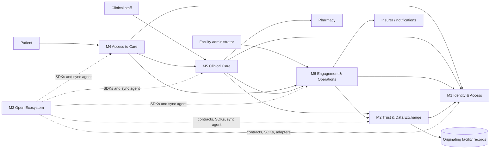

# Project Overview

## 1. Project summary

**Patient Card and Connected Care** is a proposed architecture for a
federated healthcare system. The solution allows a patient to use one
identity and card across participating healthcare facilities while allowing
each facility to retain ownership of its detailed clinical and billing data.

Shared services coordinate identity, consent, record discovery, secure
exchange, and audit. Facility services manage local registration,
appointments, clinical care, engagement, billing, and administration.

This project is an architecture study based on the
[architecture drivers](CSE752-2026-17-ArchDrivers.pdf). It describes a
solution design and module responsibilities; it is not an implementation or
a claim that all proposed components are prescribed by the source material.

## 2. Problem statement

Patients may receive care from multiple facilities, but their identity,
appointments, clinical records, consent, and follow-up activities are often
fragmented. Staff need a reliable way to identify a patient and obtain
permitted information without creating an unsafe central copy of every
facility's records.

The architecture must therefore support:

- A consistent patient identity across facilities.
- Secure, consent-aware access to records held elsewhere.
- Local ownership of detailed clinical and billing data.
- Interoperability between independent facilities and vendors.
- Safe operation during temporary connectivity failures.
- Auditable decisions and explicit handling of denial or unavailability.

## 3. Goals

1. Provide a unified patient identity (UPID) that is independent of clinical
   content.
2. Support registration, card management, appointments, check-in, clinical
   care, and follow-up operations.
3. Enforce consent and authorization for every cross-facility record request.
4. Preserve facility ownership of detailed clinical and billing records.
5. Provide open contracts and adapters so facilities can integrate
   independently.
6. Make asynchronous work retryable without creating duplicate appointments,
   orders, charges, or notifications.
7. Record access and authorization decisions in an append-only audit trail.

## 4. Stakeholders

| Stakeholder | Main interest |
| --- | --- |
| Patient | One identity, convenient care access, consent control, permitted record viewing, and understandable notifications |
| Doctor, nurse, laboratory staff, and pharmacist | Correct patient context, authenticated access, clinical history, and reliable clinical workflows |
| Facility administrator | Facility configuration, staff roles, appointment resources, billing, and operational reporting |
| Participating facility | Local ownership of records, interoperable integration, and controlled disclosure |
| Insurer | Accurate itemized claims and clear claim status |
| Platform/ecosystem team | Stable contracts, SDKs, adapters, conformance, and version compatibility |
| Auditor or compliance reviewer | Traceable identity, consent, authorization, and disclosure decisions |

## 5. Solution scope

### In scope

- Patient registration and identity matching.
- UPID and card credential lifecycle.
- Patient, staff, and administrator authentication.
- Appointment scheduling, cancellation, rescheduling, and check-in.
- Facility-owned clinical encounters and records.
- Laboratory orders, results, and prescriptions.
- Consent management and cross-facility record exchange.
- Record discovery through pointers and facility directories.
- Patient dashboard and follow-up reminders.
- Facility billing, claims, roles, and configuration.
- Open APIs, schemas, SDKs, adapters, conformance tests, and offline queueing.
- Audit, provenance, idempotency, and explicit error outcomes.

### Out of scope

- Replacing a facility's complete electronic health record system.
- Creating one central database containing all detailed clinical records.
- Defining a particular card hardware vendor or notification provider.
- Automating uncertain identity merges without human review.
- Making offline decisions that require current revocation or consent state.
- Defining clinical treatment guidelines or insurance policy rules.

## 6. High-level architecture

The solution uses a federated architecture with shared trust services and
facility-owned operational services.

Solid arrows represent runtime interactions. Dotted arrows represent
contracts, SDKs, adapters, or the embedded synchronization agent. M2
coordinates exchange but does not become the authoritative owner of another
facility's detailed clinical records.

## 7. Functional modules

| ID | Module | Summary |
| --- | --- | --- |
| M1 | Identity & Access | Creates UPIDs, authenticates users, and manages credentials |
| M2 | Trust & Data Exchange | Enforces consent, discovers records, authorizes exchange, and audits access |
| M3 | Open Ecosystem | Defines contracts and provides SDKs, adapters, tests, and offline synchronization |
| M4 | Access to Care | Handles registration, appointments, card operations, and check-in |
| M5 | Clinical Care | Manages encounters, clinical records, diagnostics, and prescriptions |
| M6 | Engagement & Operations | Handles dashboards, reminders, billing, claims, roles, and configuration |

Detailed functions, layers, dependencies, invocation rules, and design
principle mappings are documented in
[functional-modules.md](functional-modules.md).

## 8. Typical patient journey

1. A patient registers at a facility through M4.
2. M4 asks M1 to find or create the patient's UPID and issue or bind a card
   credential.
3. The patient books an appointment through M4. The facility appointment
   store confirms the slot transactionally.
4. At arrival, M4 asks M1 to validate the current card status and sends the
   checked-in visit context to M5.
5. M5 authenticates the clinician through M1 and records the encounter in the
   facility clinical store.
6. If external history is needed, M5 asks M2 to evaluate consent and obtain
   the permitted record from the originating facility.
7. M5 publishes only an allowed summary or pointer to M2 and emits a minimal
   completion or follow-up event to M6.
8. M6 creates the local billing context, schedules follow-up work, and sends a
   minimal reminder through the notification provider.
9. The patient views permitted information through a dashboard authenticated
   by M1 and mediated by M2.

## 9. Layering and design principles

Runtime modules use four conceptual layers:

1. **Interface layer:** user interfaces, APIs, events, and external adapters.
2. **Application layer:** use-case orchestration and module ports.
3. **Domain layer:** business rules, state transitions, and invariants.
4. **Infrastructure layer:** databases, queues, tokens, hardware, and
   third-party integrations.

The architecture applies the service-oriented principles from the supplied
reference image where they provide value:

- **Loose coupling:** modules communicate through contracts rather than shared
  databases.
- **Abstraction:** identity, consent, card hardware, and facility routing are
  hidden behind stable service interfaces.
- **Composability:** booking, identity, trust, clinical, billing, and
  notification capabilities can be combined into complete workflows.
- **Standardized contracts:** M3 publishes versions, schemas, errors,
  provenance, and idempotency rules.
- **Reusability:** M1 and M2 are reused by several facility workflows.
- **Autonomy:** facilities retain control of local clinical, appointment, and
  billing state.
- **Statelessness:** request handlers avoid process-local business state;
  durable state is kept in authoritative stores, queues, or workflow records.
- **Discoverability:** service contracts and facility/provider metadata are
  published so implementations can find and use supported capabilities.

These principles are guidance for evaluating the design rather than a
requirement to force every principle onto every interaction.

## 10. Reliability, security, and data ownership

- M1 checks current card revocation status for every card use.
- M2 requires an authorization decision and audit entry before disclosure.
- M2 stores record pointers and provenance rather than duplicating detailed
  records.
- Facility databases remain authoritative for appointments, clinical records,
  billing, and local configuration.
- Queued operations use idempotency keys and return accepted, rejected,
  pending, or conflict outcomes.
- Offline mode supports eligible local work but does not silently approve
  cross-facility disclosure or an unavailable card-status check.
- External services return explicit failure states rather than success-shaped
  fallbacks.
- Clinical and identity conflicts require review instead of automatic
  last-write-wins resolution.

## 11. Assumptions and architectural decisions

- Participating facilities can expose a versioned API or use an M3 adapter.
- A shared identity service is reachable for authentication and current
  credential validation during protected operations.
- Patients can grant or withdraw consent using an authorized channel.
- Facilities remain legally and operationally responsible for their detailed
  records.
- The system uses a federated exchange model rather than a central clinical
  data warehouse.
- Synchronous calls are used for decisions that must be authoritative, such
  as booking, card validity, consent, and authorization.
- Events and queues are used for retryable work, such as reminders and
  follow-up processing.

## 12. Related documentation

- [Functional Modules](functional-modules.md) — detailed module functions,
  layers, invocations, dependencies, and principles.
- [README](README.md) — architecture rationale and module diagrams.
- [Architecture Drivers](CSE752-2026-17-ArchDrivers.pdf) — source material
  used to frame the architecture study.
